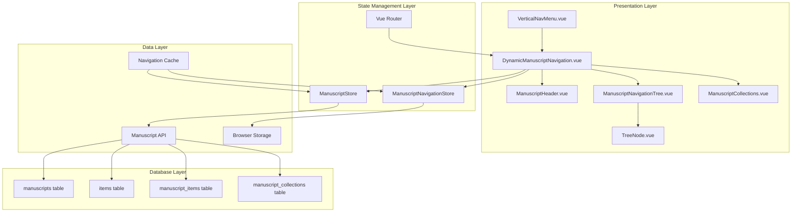

# Manuscript Navigation System Architecture

## 🏗️ **System Overview**

The Manuscript Navigation System is a complex, hierarchical navigation solution that dynamically displays manuscript content in a tree structure within the application's vertical navigation menu. This document provides detailed technical architecture, design patterns, and implementation strategies for building this system.

## 🎯 **Architecture Goals**

- **Performance**: Handle manuscripts with 1000+ items efficiently
- **Scalability**: Support complex hierarchical structures without degradation
- **Maintainability**: Clean, modular architecture with clear separation of concerns
- **Extensibility**: Easy to add new content types and organizational patterns
- **Accessibility**: Full keyboard navigation and screen reader support
- **Responsive**: Seamless experience across all device sizes

## 📊 **System Architecture Diagram**



## 🧩 **Component Architecture**

### **Core Components Structure**

```typescript
// Component hierarchy with responsibilities
interface ComponentArchitecture {
  // Root navigation container
  DynamicManuscriptNavigation: {
    responsibilities: [
      'Visibility management based on selected manuscript',
      'Layout coordination between header, tree, and collections',
      'Event delegation and communication hub',
      'Performance monitoring and optimization'
    ],
    children: ['ManuscriptHeader', 'ManuscriptNavigationTree', 'ManuscriptCollections']
  },

  // Header with manuscript info and actions
  ManuscriptHeader: {
    responsibilities: [
      'Display manuscript title and metadata',
      'Provide quick actions (search, settings, etc.)',
      'Show manuscript status and progress',
      'Handle manuscript-level operations'
    ],
    children: ['QuickActions', 'SearchInput', 'SettingsMenu']
  },

  // Main tree navigation component
  ManuscriptNavigationTree: {
    responsibilities: [
      'Render hierarchical tree structure',
      'Handle virtual scrolling for performance',
      'Manage expand/collapse state',
      'Coordinate drag and drop operations'
    ],
    children: ['TreeNode', 'VirtualScroller', 'EmptyState']
  },

  // Individual tree nodes (recursive)
  TreeNode: {
    responsibilities: [
      'Render individual tree items',
      'Handle node-specific interactions',
      'Manage child node rendering',
      'Provide context menus and actions'
    ],
    children: ['NodeIcon', 'NodeLabel', 'NodeActions', 'NodeChildren']
  },

  // Collections view (Scrivener-style)
  ManuscriptCollections: {
    responsibilities: [
      'Display Scrivener collections and binders',
      'Handle collection-specific interactions',
      'Support different collection types',
      'Provide collection management features'
    ],
    children: ['CollectionGroup', 'CollectionItem']
  }
}
```

### **Component Communication Patterns**

```typescript
// Event flow and communication patterns
interface CommunicationArchitecture {
  // Parent-to-child communication
  propsFlow: {
    'DynamicManuscriptNavigation -> ManuscriptNavigationTree': [
      'manuscriptTree: TreeNode[]',
      'selectedNode: string | null',
      'expandedNodes: Set<string>',
      'searchQuery: string'
    ],
    'ManuscriptNavigationTree -> TreeNode': [
      'node: TreeNode',
      'level: number',
      'isExpanded: boolean',
      'isSelected: boolean'
    ]
  },

  // Child-to-parent communication
  eventsFlow: {
    'TreeNode -> ManuscriptNavigationTree': [
      'node-click: (nodeId: string)',
      'node-expand: (nodeId: string)',
      'node-collapse: (nodeId: string)',
      'node-context-menu: (nodeId: string, event: MouseEvent)'
    ],
    'ManuscriptNavigationTree -> DynamicManuscriptNavigation': [
      'navigate: (path: string)',
      'selection-change: (nodeId: string)',
      'structure-change: (operation: TreeOperation)'
    ]
  },

  // Store-based communication
  storeIntegration: {
    'Components -> Stores': [
      'useManuscriptStore() for manuscript data',
      'useManuscriptNavigationStore() for UI state',
      'useRouter() for navigation'
    ],
    'Stores -> Components': [
      'Reactive data updates via computed properties',
      'Watch handlers for complex state changes'
    ]
  }
}
```

## 🗃️ **State Management Architecture**

### **Enhanced Manuscript Store**

```typescript
// Enhanced manuscript store with navigation capabilities
export const useManuscriptStore = defineStore('manuscript', () => {
  // Existing state
  const manuscripts = ref<Manuscript[]>([])
  const currentManuscript = ref<Manuscript | null>(null)
  const selectedManuscriptId = ref<number | null>(null)

  // New navigation-specific state
  const manuscriptTree = ref<TreeNode[]>([])
  const treeMetadata = ref<TreeMetadata>({
    totalItems: 0,
    totalWords: 0,
    lastModified: null,
    structure: 'hierarchical'
  })
  const flatItemsIndex = ref<Map<string, TreeNode>>(new Map())

  // Tree building logic
  const buildNavigationTree = (items: Item[]): TreeNode[] => {
    const nodeMap = new Map<number, TreeNode>()
    const rootNodes: TreeNode[] = []

    // Phase 1: Create all nodes with metadata
    items.forEach(item => {
      const node: TreeNode = {
        id: `item-${item.id}`,
        itemId: item.id,
        title: item.title,
        type: item.type as NodeType,
        icon: getIconForItemType(item.type),
        path: `/manuscripts/${selectedManuscriptId.value}/items/${item.id}`,
        children: [],
        metadata: {
          wordCount: item.word_count || 0,
          characterCount: item.character_count || 0,
          status: item.metadata?.status || 'draft',
          lastModified: item.updated_at,
          hasComments: (item.metadata?.comment_count || 0) > 0,
          isCompilable: item.include_in_compile !== false,
          synopsis: item.synopsis
        },
        state: {
          isExpanded: false,
          isSelected: false,
          isLoading: false,
          isDragging: false
        }
      }

      nodeMap.set(item.id, node)
      flatItemsIndex.value.set(node.id, node)
    })

    // Phase 2: Build hierarchy based on parent_id
    items.forEach(item => {
      const node = nodeMap.get(item.id)!
      if (item.parent_id && nodeMap.has(item.parent_id)) {
        const parent = nodeMap.get(item.parent_id)!
        parent.children.push(node)
        node.parent = parent
      } else {
        rootNodes.push(node)
      }
    })

    // Phase 3: Sort nodes by order_index
    const sortNodes = (nodes: TreeNode[]) => {
      nodes.sort((a, b) => {
        const aItem = items.find(item => item.id === a.itemId)!
        const bItem = items.find(item => item.id === b.itemId)!
        return (aItem.item_order || 0) - (bItem.item_order || 0)
      })
      nodes.forEach(node => {
        if (node.children.length > 0) {
          sortNodes(node.children)
        }
      })
    }

    sortNodes(rootNodes)
    return rootNodes
  }

  // Tree manipulation methods
  const updateTreeStructure = async (operation: TreeOperation) => {
    switch (operation.type) {
      case 'move':
        await moveItem(operation.nodeId, operation.targetId, operation.position)
        break
      case 'reorder':
        await reorderItems(operation.nodeIds, operation.newOrder)
        break
      case 'create':
        await createItem(operation.parentId, operation.itemData)
        break
      case 'delete':
        await deleteItem(operation.nodeId)
        break
    }

    // Refresh tree after operation
    await fetchManuscriptItems(selectedManuscriptId.value!)
  }

  // Tree query methods
  const findNodeById = (nodeId: string): TreeNode | null => {
    return flatItemsIndex.value.get(nodeId) || null
  }

  const findNodesByType = (type: NodeType): TreeNode[] => {
    return Array.from(flatItemsIndex.value.values())
      .filter(node => node.type === type)
  }

  const getNodePath = (nodeId: string): TreeNode[] => {
    const node = findNodeById(nodeId)
    if (!node) return []

    const path: TreeNode[] = []
    let current = node
    while (current) {
      path.unshift(current)
      current = current.parent
    }
    return path
  }

  // API integration methods
  const fetchManuscriptItems = async (manuscriptId: number) => {
    try {
      loading.value = true
      const response = await api.get(`/manuscripts/${manuscriptId}/items`)

      if (response.data?.data) {
        const items = response.data.data
        manuscriptTree.value = buildNavigationTree(items)
        treeMetadata.value = calculateTreeMetadata(items)
      }
    } catch (err: any) {
      console.error('Failed to fetch manuscript items:', err)
      error.value = err.message || 'Failed to load manuscript structure'
    } finally {
      loading.value = false
    }
  }

  const moveItem = async (itemId: string, targetId: string, position: 'before' | 'after' | 'inside') => {
    const nodeItemId = parseInt(itemId.replace('item-', ''))
    const targetItemId = parseInt(targetId.replace('item-', ''))

    await api.post(`/manuscripts/${selectedManuscriptId.value}/items/${nodeItemId}/move`, {
      target_id: targetItemId,
      position
    })
  }

  const reorderItems = async (itemIds: string[], newOrder: number[]) => {
    const reorderData = itemIds.map((id, index) => ({
      item_id: parseInt(id.replace('item-', '')),
      order_index: newOrder[index]
    }))

    await api.post(`/manuscripts/${selectedManuscriptId.value}/items/reorder`, {
      items: reorderData
    })
  }

  return {
    // Existing exports
    manuscripts,
    currentManuscript,
    selectedManuscriptId,
    loading,
    error,

    // New navigation exports
    manuscriptTree,
    treeMetadata,
    flatItemsIndex,

    // Methods
    buildNavigationTree,
    updateTreeStructure,
    findNodeById,
    findNodesByType,
    getNodePath,
    fetchManuscriptItems,

    // Computed
    hasSelectedManuscript: computed(() => selectedManuscriptId.value !== null),
    treeNodeCount: computed(() => flatItemsIndex.value.size),
    treeDepth: computed(() => calculateMaxDepth(manuscriptTree.value))
  }
})
```

### **Navigation-Specific Store**

```typescript
// Dedicated store for navigation UI state
export const useManuscriptNavigationStore = defineStore('manuscriptNavigation', () => {
  // UI state
  const expandedNodes = ref<Set<string>>(new Set())
  const selectedNode = ref<string | null>(null)
  const searchQuery = ref<string>('')
  const viewMode = ref<NavigationViewMode>('tree')
  const sortBy = ref<SortOption>('order')
  const filterBy = ref<FilterOptions>({
    types: [],
    status: [],
    hasComments: null
  })

  // Performance state
  const virtualScrolling = ref<boolean>(false)
  const visibleNodeRange = ref<{ start: number; end: number }>({ start: 0, end: 50 })
  const scrollPosition = ref<number>(0)

  // Interaction state
  const dragState = ref<DragState>({
    isDragging: false,
    draggedNode: null,
    dropTarget: null,
    dropPosition: null
  })

  // Persistence keys
  const STORAGE_KEYS = {
    expandedNodes: 'manuscriptNav.expandedNodes',
    viewMode: 'manuscriptNav.viewMode',
    sortBy: 'manuscriptNav.sortBy'
  }

  // Initialize from localStorage
  const initializeFromStorage = () => {
    try {
      const savedExpanded = localStorage.getItem(STORAGE_KEYS.expandedNodes)
      if (savedExpanded) {
        expandedNodes.value = new Set(JSON.parse(savedExpanded))
      }

      const savedViewMode = localStorage.getItem(STORAGE_KEYS.viewMode)
      if (savedViewMode) {
        viewMode.value = savedViewMode as NavigationViewMode
      }

      const savedSortBy = localStorage.getItem(STORAGE_KEYS.sortBy)
      if (savedSortBy) {
        sortBy.value = savedSortBy as SortOption
      }
    } catch (error) {
      console.warn('Failed to load navigation state from storage:', error)
    }
  }

  // Persistence watchers
  watch(expandedNodes, (newNodes) => {
    localStorage.setItem(STORAGE_KEYS.expandedNodes, JSON.stringify([...newNodes]))
  }, { deep: true })

  watch(viewMode, (newMode) => {
    localStorage.setItem(STORAGE_KEYS.viewMode, newMode)
  })

  watch(sortBy, (newSort) => {
    localStorage.setItem(STORAGE_KEYS.sortBy, newSort)
  })

  // Node expansion methods
  const toggleNode = (nodeId: string) => {
    if (expandedNodes.value.has(nodeId)) {
      expandedNodes.value.delete(nodeId)
    } else {
      expandedNodes.value.add(nodeId)
    }
  }

  const expandNode = (nodeId: string) => {
    expandedNodes.value.add(nodeId)
  }

  const collapseNode = (nodeId: string) => {
    expandedNodes.value.delete(nodeId)
  }

  const expandAll = () => {
    const manuscriptStore = useManuscriptStore()
    manuscriptStore.flatItemsIndex.forEach((node, nodeId) => {
      if (node.children.length > 0) {
        expandedNodes.value.add(nodeId)
      }
    })
  }

  const collapseAll = () => {
    expandedNodes.value.clear()
  }

  // Selection methods
  const selectNode = (nodeId: string | null) => {
    selectedNode.value = nodeId
  }

  const clearSelection = () => {
    selectedNode.value = null
  }

  // Search and filter methods
  const setSearchQuery = (query: string) => {
    searchQuery.value = query
  }

  const clearSearch = () => {
    searchQuery.value = ''
  }

  const setFilter = (filter: Partial<FilterOptions>) => {
    filterBy.value = { ...filterBy.value, ...filter }
  }

  const clearFilters = () => {
    filterBy.value = {
      types: [],
      status: [],
      hasComments: null
    }
  }

  // View mode methods
  const setViewMode = (mode: NavigationViewMode) => {
    viewMode.value = mode
  }

  const setSortBy = (sort: SortOption) => {
    sortBy.value = sort
  }

  // Drag and drop methods
  const startDrag = (nodeId: string) => {
    dragState.value = {
      isDragging: true,
      draggedNode: nodeId,
      dropTarget: null,
      dropPosition: null
    }
  }

  const updateDragTarget = (targetId: string | null, position: DropPosition | null) => {
    if (dragState.value.isDragging) {
      dragState.value.dropTarget = targetId
      dragState.value.dropPosition = position
    }
  }

  const endDrag = () => {
    dragState.value = {
      isDragging: false,
      draggedNode: null,
      dropTarget: null,
      dropPosition: null
    }
  }

  // Virtual scrolling methods
  const updateVisibleRange = (start: number, end: number) => {
    visibleNodeRange.value = { start, end }
  }

  const setScrollPosition = (position: number) => {
    scrollPosition.value = position
  }

  const enableVirtualScrolling = () => {
    virtualScrolling.value = true
  }

  const disableVirtualScrolling = () => {
    virtualScrolling.value = false
  }

  // Initialize on store creation
  initializeFromStorage()

  return {
    // State
    expandedNodes: readonly(expandedNodes),
    selectedNode: readonly(selectedNode),
    searchQuery: readonly(searchQuery),
    viewMode: readonly(viewMode),
    sortBy: readonly(sortBy),
    filterBy: readonly(filterBy),
    virtualScrolling: readonly(virtualScrolling),
    visibleNodeRange: readonly(visibleNodeRange),
    scrollPosition: readonly(scrollPosition),
    dragState: readonly(dragState),

    // Node methods
    toggleNode,
    expandNode,
    collapseNode,
    expandAll,
    collapseAll,

    // Selection methods
    selectNode,
    clearSelection,

    // Search/filter methods
    setSearchQuery,
    clearSearch,
    setFilter,
    clearFilters,

    // View methods
    setViewMode,
    setSortBy,

    // Drag/drop methods
    startDrag,
    updateDragTarget,
    endDrag,

    // Virtual scrolling methods
    updateVisibleRange,
    setScrollPosition,
    enableVirtualScrolling,
    disableVirtualScrolling,

    // Computed
    hasActiveSearch: computed(() => searchQuery.value.length > 0),
    hasActiveFilters: computed(() =>
      filterBy.value.types.length > 0 ||
      filterBy.value.status.length > 0 ||
      filterBy.value.hasComments !== null
    ),
    isTreeMode: computed(() => viewMode.value === 'tree'),
    isFlatMode: computed(() => viewMode.value === 'flat'),
    isCollectionsMode: computed(() => viewMode.value === 'collections')
  }
})
```

## 🎯 **Performance Architecture**

### **Virtual Scrolling Implementation**

```typescript
// High-performance virtual scrolling for large trees
class VirtualTreeScroller {
  private itemHeight = 32 // Fixed height per tree item
  private containerHeight = 0
  private scrollTop = 0
  private visibleItems: TreeNode[] = []
  private startIndex = 0
  private endIndex = 0

  constructor(
    private flattenedNodes: TreeNode[],
    private container: HTMLElement
  ) {
    this.containerHeight = container.clientHeight
    this.calculateVisibleRange()
  }

  private calculateVisibleRange() {
    const visibleCount = Math.ceil(this.containerHeight / this.itemHeight)
    const buffer = Math.floor(visibleCount / 2) // Render buffer for smooth scrolling

    this.startIndex = Math.max(0, Math.floor(this.scrollTop / this.itemHeight) - buffer)
    this.endIndex = Math.min(
      this.flattenedNodes.length - 1,
      this.startIndex + visibleCount + (buffer * 2)
    )

    this.visibleItems = this.flattenedNodes.slice(this.startIndex, this.endIndex + 1)
  }

  public updateScroll(scrollTop: number) {
    this.scrollTop = scrollTop
    this.calculateVisibleRange()
  }

  public getVisibleItems(): VirtualTreeItem[] {
    return this.visibleItems.map((node, index) => ({
      node,
      index: this.startIndex + index,
      offsetTop: (this.startIndex + index) * this.itemHeight
    }))
  }

  public getTotalHeight(): number {
    return this.flattenedNodes.length * this.itemHeight
  }

  public getSpacerHeight(position: 'top' | 'bottom'): number {
    if (position === 'top') {
      return this.startIndex * this.itemHeight
    } else {
      const remainingItems = this.flattenedNodes.length - (this.endIndex + 1)
      return remainingItems * this.itemHeight
    }
  }
}

// Vue composable for virtual scrolling
export function useVirtualTreeScrolling(nodes: Ref<TreeNode[]>) {
  const scrollContainer = ref<HTMLElement>()
  const scroller = ref<VirtualTreeScroller>()
  const visibleItems = ref<VirtualTreeItem[]>([])
  const totalHeight = ref(0)
  const topSpacerHeight = ref(0)
  const bottomSpacerHeight = ref(0)

  // Flatten tree for virtual scrolling
  const flattenTree = (nodes: TreeNode[], level = 0): TreeNode[] => {
    const navigationStore = useManuscriptNavigationStore()
    const result: TreeNode[] = []

    for (const node of nodes) {
      result.push({ ...node, level })

      if (node.children.length > 0 && navigationStore.expandedNodes.has(node.id)) {
        result.push(...flattenTree(node.children, level + 1))
      }
    }

    return result
  }

  const flattenedNodes = computed(() => flattenTree(nodes.value))

  // Update virtual scroller when nodes change
  watch([flattenedNodes, scrollContainer], ([newNodes, container]) => {
    if (container && newNodes.length > 0) {
      scroller.value = new VirtualTreeScroller(newNodes, container)
      updateVisibleItems()
    }
  })

  const updateVisibleItems = () => {
    if (!scroller.value) return

    visibleItems.value = scroller.value.getVisibleItems()
    totalHeight.value = scroller.value.getTotalHeight()
    topSpacerHeight.value = scroller.value.getSpacerHeight('top')
    bottomSpacerHeight.value = scroller.value.getSpacerHeight('bottom')
  }

  const handleScroll = (event: Event) => {
    const target = event.target as HTMLElement
    if (scroller.value) {
      scroller.value.updateScroll(target.scrollTop)
      updateVisibleItems()
    }
  }

  return {
    scrollContainer,
    visibleItems,
    totalHeight,
    topSpacerHeight,
    bottomSpacerHeight,
    handleScroll
  }
}
```

### **Tree Building Optimization**

```typescript
// Optimized tree building with memoization
class OptimizedTreeBuilder {
  private itemsCache = new Map<string, TreeNode[]>()
  private lastBuildTime = 0
  private buildThreshold = 100 // Rebuild only if more than 100ms since last build

  buildTree(items: Item[], manuscriptId: number): TreeNode[] {
    const cacheKey = this.generateCacheKey(items, manuscriptId)
    const now = Date.now()

    // Return cached result if recent and items haven't changed
    if (this.itemsCache.has(cacheKey) &&
        (now - this.lastBuildTime) < this.buildThreshold) {
      return this.itemsCache.get(cacheKey)!
    }

    const tree = this.performTreeBuild(items, manuscriptId)
    this.itemsCache.set(cacheKey, tree)
    this.lastBuildTime = now

    return tree
  }

  private generateCacheKey(items: Item[], manuscriptId: number): string {
    // Create cache key based on items and their modification times
    const itemSignature = items
      .map(item => `${item.id}:${item.updated_at}:${item.parent_id}:${item.item_order}`)
      .sort()
      .join('|')

    return `${manuscriptId}:${itemSignature}`
  }

  private performTreeBuild(items: Item[], manuscriptId: number): TreeNode[] {
    // Implementation details as shown in previous sections
    // ... tree building logic
  }

  clearCache() {
    this.itemsCache.clear()
  }
}

// Memory management for large trees
class TreeMemoryManager {
  private maxCacheSize = 10 // Maximum number of cached trees
  private treeCache = new Map<number, { tree: TreeNode[], timestamp: number }>()

  getCachedTree(manuscriptId: number): TreeNode[] | null {
    const cached = this.treeCache.get(manuscriptId)
    if (cached) {
      // Update timestamp for LRU management
      cached.timestamp = Date.now()
      return cached.tree
    }
    return null
  }

  setCachedTree(manuscriptId: number, tree: TreeNode[]) {
    // Implement LRU eviction if cache is full
    if (this.treeCache.size >= this.maxCacheSize) {
      const oldestEntry = Array.from(this.treeCache.entries())
        .sort((a, b) => a[1].timestamp - b[1].timestamp)[0]

      this.treeCache.delete(oldestEntry[0])
    }

    this.treeCache.set(manuscriptId, {
      tree: this.deepCloneTree(tree),
      timestamp: Date.now()
    })
  }

  private deepCloneTree(tree: TreeNode[]): TreeNode[] {
    // Efficient deep cloning of tree structure
    return tree.map(node => ({
      ...node,
      children: this.deepCloneTree(node.children),
      parent: undefined // Rebuild parent references separately
    }))
  }

  clearCache() {
    this.treeCache.clear()
  }
}
```

## 🔌 **Integration Architecture**

### **Router Integration**

```typescript
// Router integration for navigation state sync
export function useNavigationRouterIntegration() {
  const router = useRouter()
  const route = useRoute()
  const manuscriptStore = useManuscriptStore()
  const navigationStore = useManuscriptNavigationStore()

  // Sync selected node with current route
  watch(() => route.params, (params) => {
    if (params.manuscriptId && params.itemId) {
      const nodeId = `item-${params.itemId}`
      navigationStore.selectNode(nodeId)

      // Ensure path to selected node is expanded
      const nodePath = manuscriptStore.getNodePath(nodeId)
      nodePath.forEach(node => {
        if (node.children.length > 0) {
          navigationStore.expandNode(node.id)
        }
      })
    }
  }, { immediate: true })

  // Navigate when node is selected
  const navigateToNode = (nodeId: string) => {
    const node = manuscriptStore.findNodeById(nodeId)
    if (node) {
      router.push(node.path)
    }
  }

  // Update URL when tree structure changes
  const updateRouteForTreeChange = (operation: TreeOperation) => {
    // Handle route updates for tree modifications
    if (operation.type === 'move' &&
        navigationStore.selectedNode === operation.nodeId) {
      // Update route if currently selected node was moved
      const node = manuscriptStore.findNodeById(operation.nodeId)
      if (node) {
        router.replace(node.path)
      }
    }
  }

  return {
    navigateToNode,
    updateRouteForTreeChange
  }
}
```

### **Content View Synchronization**

```typescript
// Bidirectional sync with content views
export function useContentViewSync() {
  const manuscriptStore = useManuscriptStore()
  const navigationStore = useManuscriptNavigationStore()

  // Highlight current content in navigation
  const syncNavigationWithContent = () => {
    const route = useRoute()
    if (route.params.itemId) {
      const nodeId = `item-${route.params.itemId}`
      navigationStore.selectNode(nodeId)
    }
  }

  // Update content when navigation selection changes
  const syncContentWithNavigation = () => {
    watch(() => navigationStore.selectedNode, (nodeId) => {
      if (nodeId) {
        const node = manuscriptStore.findNodeById(nodeId)
        if (node) {
          // Emit event for content views to update
          document.dispatchEvent(new CustomEvent('manuscript-navigation-change', {
            detail: { node, path: node.path }
          }))
        }
      }
    })
  }

  // Handle content modifications affecting navigation
  const handleContentModification = (itemId: number, changes: Partial<Item>) => {
    const nodeId = `item-${itemId}`
    const node = manuscriptStore.findNodeById(nodeId)

    if (node && changes.title) {
      // Update node title in navigation
      node.title = changes.title
    }

    if (changes.word_count !== undefined) {
      // Update word count metadata
      if (node?.metadata) {
        node.metadata.wordCount = changes.word_count
      }
    }
  }

  return {
    syncNavigationWithContent,
    syncContentWithNavigation,
    handleContentModification
  }
}
```

## 🎭 **Error Handling Architecture**

### **Graceful Degradation**

```typescript
// Error handling and graceful degradation
export class NavigationErrorHandler {
  private fallbackTree: TreeNode[] = []
  private errorState = ref<NavigationError | null>(null)
  private retryCount = 0
  private maxRetries = 3

  async handleTreeBuildError(error: Error, items: Item[]): Promise<TreeNode[]> {
    console.error('Tree building failed:', error)

    // Attempt to build simplified tree
    try {
      return this.buildFallbackTree(items)
    } catch (fallbackError) {
      console.error('Fallback tree building failed:', fallbackError)
      this.setErrorState('tree-build-failed', error.message)
      return this.fallbackTree
    }
  }

  private buildFallbackTree(items: Item[]): TreeNode[] {
    // Build flat tree as fallback
    return items.map(item => ({
      id: `item-${item.id}`,
      itemId: item.id,
      title: item.title || 'Untitled',
      type: item.type as NodeType || 'text',
      icon: 'bx-file',
      path: `/manuscripts/${item.manuscript_id}/items/${item.id}`,
      children: [],
      metadata: {
        wordCount: item.word_count || 0,
        status: 'unknown',
        lastModified: item.updated_at
      },
      state: {
        isExpanded: false,
        isSelected: false,
        isLoading: false,
        isDragging: false
      }
    }))
  }

  async handleApiError(error: Error, operation: string): Promise<void> {
    this.retryCount++

    if (this.retryCount <= this.maxRetries) {
      // Implement exponential backoff
      const delay = Math.pow(2, this.retryCount) * 1000
      await new Promise(resolve => setTimeout(resolve, delay))

      // Retry the operation
      try {
        await this.retryOperation(operation)
        this.clearErrorState()
      } catch (retryError) {
        await this.handleApiError(retryError as Error, operation)
      }
    } else {
      this.setErrorState('api-error', `Failed after ${this.maxRetries} retries: ${error.message}`)
    }
  }

  private async retryOperation(operation: string): Promise<void> {
    // Implement retry logic based on operation type
    switch (operation) {
      case 'fetch-items':
        await this.retryFetchItems()
        break
      case 'move-item':
        await this.retryMoveItem()
        break
      // Add other operation retries
    }
  }

  private setErrorState(type: string, message: string) {
    this.errorState.value = {
      type,
      message,
      timestamp: new Date(),
      canRetry: this.retryCount < this.maxRetries
    }
  }

  private clearErrorState() {
    this.errorState.value = null
    this.retryCount = 0
  }

  public getErrorState(): NavigationError | null {
    return this.errorState.value
  }

  public retry(): void {
    if (this.errorState.value?.canRetry) {
      this.clearErrorState()
      // Trigger retry of last failed operation
    }
  }
}
```

## 📱 **Responsive Architecture**

### **Adaptive Navigation**

```typescript
// Responsive navigation behavior
export function useResponsiveNavigation() {
  const breakpoints = {
    mobile: 768,
    tablet: 1024,
    desktop: 1200
  }

  const screenSize = ref<'mobile' | 'tablet' | 'desktop'>('desktop')
  const navigationMode = ref<'drawer' | 'sidebar' | 'embedded'>('sidebar')

  // Detect screen size changes
  const updateScreenSize = () => {
    const width = window.innerWidth

    if (width < breakpoints.mobile) {
      screenSize.value = 'mobile'
      navigationMode.value = 'drawer'
    } else if (width < breakpoints.tablet) {
      screenSize.value = 'tablet'
      navigationMode.value = 'drawer'
    } else {
      screenSize.value = 'desktop'
      navigationMode.value = 'sidebar'
    }
  }

  // Responsive tree rendering
  const getTreeConfig = () => {
    switch (screenSize.value) {
      case 'mobile':
        return {
          showIcons: true,
          showMetadata: false,
          maxDepth: 2,
          virtualScrolling: true,
          itemHeight: 44,
          showActions: false
        }
      case 'tablet':
        return {
          showIcons: true,
          showMetadata: true,
          maxDepth: 4,
          virtualScrolling: true,
          itemHeight: 36,
          showActions: true
        }
      case 'desktop':
        return {
          showIcons: true,
          showMetadata: true,
          maxDepth: -1, // No limit
          virtualScrolling: false,
          itemHeight: 32,
          showActions: true
        }
    }
  }

  // Initialize and set up listeners
  onMounted(() => {
    updateScreenSize()
    window.addEventListener('resize', updateScreenSize)
  })

  onUnmounted(() => {
    window.removeEventListener('resize', updateScreenSize)
  })

  return {
    screenSize: readonly(screenSize),
    navigationMode: readonly(navigationMode),
    treeConfig: computed(getTreeConfig),
    isMobile: computed(() => screenSize.value === 'mobile'),
    isTablet: computed(() => screenSize.value === 'tablet'),
    isDesktop: computed(() => screenSize.value === 'desktop')
  }
}
```

## 🔧 **TypeScript Interfaces**

### **Core Type Definitions**

```typescript
// Complete type system for navigation architecture
export interface TreeNode {
  id: string
  itemId: number
  title: string
  type: NodeType
  icon: string
  path: string
  children: TreeNode[]
  parent?: TreeNode
  metadata: NodeMetadata
  state: NodeState
}

export interface NodeMetadata {
  wordCount: number
  characterCount: number
  status: 'draft' | 'in_progress' | 'completed' | 'archived'
  lastModified: string
  hasComments: boolean
  isCompilable: boolean
  synopsis?: string
  tags?: string[]
  customFields?: Record<string, any>
}

export interface NodeState {
  isExpanded: boolean
  isSelected: boolean
  isLoading: boolean
  isDragging: boolean
  isHighlighted?: boolean
  hasError?: boolean
}

export type NodeType =
  | 'folder'
  | 'text'
  | 'research'
  | 'character'
  | 'mindmap'
  | 'image'
  | 'file'
  | 'link'
  | 'collection'

export type NavigationViewMode = 'tree' | 'flat' | 'collections'
export type SortOption = 'order' | 'name' | 'modified' | 'type' | 'status'
export type DropPosition = 'before' | 'after' | 'inside'

export interface TreeOperation {
  type: 'move' | 'reorder' | 'create' | 'delete' | 'update'
  nodeId: string
  targetId?: string
  position?: DropPosition
  nodeIds?: string[]
  newOrder?: number[]
  parentId?: string
  itemData?: Partial<Item>
  metadata?: Record<string, any>
}

export interface FilterOptions {
  types: NodeType[]
  status: string[]
  hasComments: boolean | null
  dateRange?: {
    start: Date
    end: Date
  }
  tags?: string[]
}

export interface DragState {
  isDragging: boolean
  draggedNode: string | null
  dropTarget: string | null
  dropPosition: DropPosition | null
}

export interface NavigationError {
  type: string
  message: string
  timestamp: Date
  canRetry: boolean
  details?: any
}

export interface TreeMetadata {
  totalItems: number
  totalWords: number
  lastModified: string | null
  structure: 'hierarchical' | 'flat'
  maxDepth: number
  itemTypeCount: Record<NodeType, number>
}

export interface VirtualTreeItem {
  node: TreeNode
  index: number
  offsetTop: number
}
```

This comprehensive architecture provides a solid foundation for building the Dynamic Manuscript Navigation System with excellent performance, maintainability, and extensibility characteristics.

---

*This document provides the complete technical architecture for the manuscript navigation system. It should be used as the primary reference for implementation and maintained as the system evolves.*

**Document Version**: 1.0
**Last Updated**: January 2025
**Next Review**: February 2025
**Maintainer**: Development Team