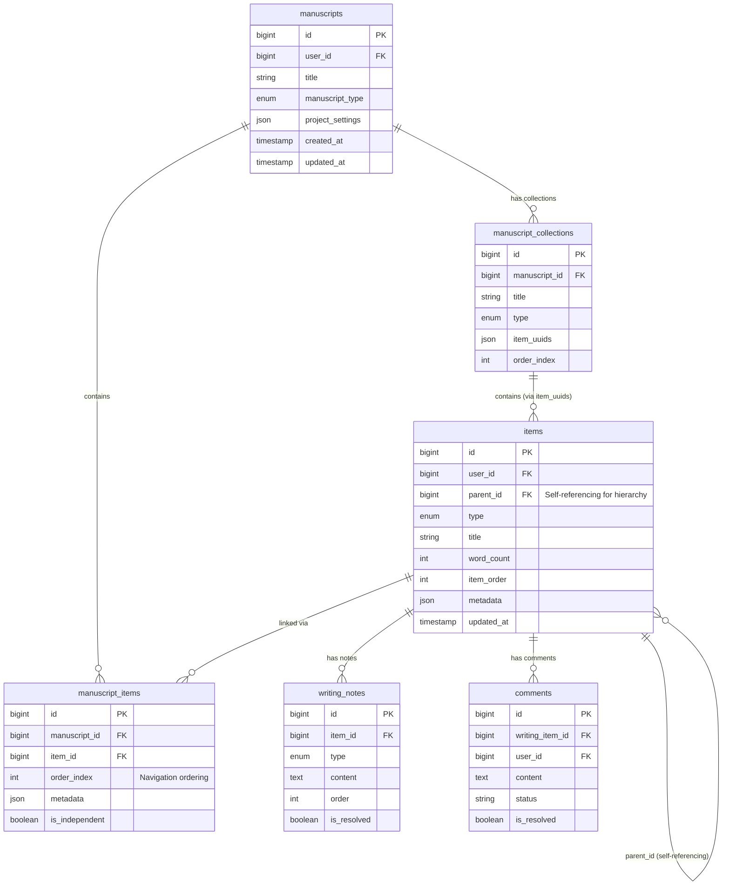
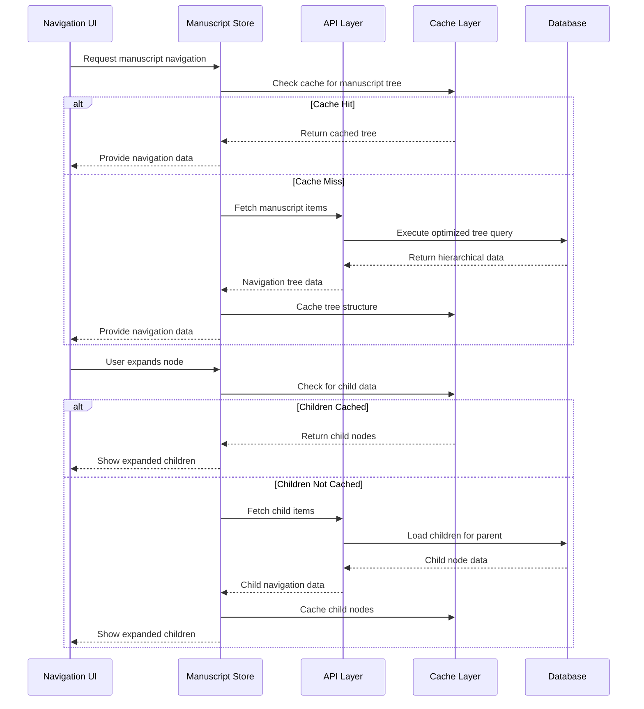

# Manuscript Navigation Database Schema

## 🗃️ **Overview**

This document provides comprehensive analysis of the database schema that supports the Dynamic Manuscript Navigation System. It covers entity relationships, query patterns, indexing strategies, and data flow optimization for efficient hierarchical navigation.

## 📊 **Core Schema Analysis**

### **Primary Tables for Navigation**

#### **`manuscripts` Table**
**Purpose**: Container for manuscript metadata and settings

```sql
CREATE TABLE manuscripts (
  id BIGINT UNSIGNED PRIMARY KEY AUTO_INCREMENT,
  user_id BIGINT UNSIGNED NOT NULL,
  title VARCHAR(191) NOT NULL,
  manuscript_type ENUM('standard', 'scrivener') NOT NULL DEFAULT 'standard',
  scrivener_uuid VARCHAR(191) NULL,
  version VARCHAR(50) NULL,
  imported_at TIMESTAMP NULL,
  project_settings JSON NULL,
  compile_settings JSON NULL,
  custom_metadata JSON NULL,
  last_compiled_at TIMESTAMP NULL,
  last_exported_at TIMESTAMP NULL,
  last_synced_at TIMESTAMP NULL,
  description TEXT NULL,
  status VARCHAR(191) NOT NULL DEFAULT 'draft',
  created_at TIMESTAMP NULL,
  updated_at TIMESTAMP NULL,
  deleted_at TIMESTAMP NULL,

  INDEX idx_user_id (user_id),
  INDEX idx_manuscript_type (manuscript_type),
  INDEX idx_scrivener_uuid (scrivener_uuid),
  INDEX idx_imported_at (imported_at),
  UNIQUE KEY unique_user_scrivener_uuid (user_id, scrivener_uuid)
);
```

**Navigation Relevance**:
- Container for all navigation content
- `title` displays in navigation header
- `manuscript_type` affects navigation behavior (Scrivener vs. standard)
- `project_settings` may contain navigation preferences

#### **`items` Table**
**Purpose**: Core content items that form the navigation tree

```sql
CREATE TABLE items (
  id BIGINT UNSIGNED PRIMARY KEY AUTO_INCREMENT,
  user_id BIGINT UNSIGNED NOT NULL,
  type ENUM('text', 'image', 'link', 'file', 'mindmap', 'compiled_output') NOT NULL,
  scrivener_uuid VARCHAR(191) NULL UNIQUE,
  folder_type VARCHAR(50) NULL,
  icon_name VARCHAR(100) NULL,
  include_in_compile TINYINT(1) NULL,
  target_type ENUM('Words', 'Characters') NULL,
  target_count INT UNSIGNED NULL,
  target_notify TINYINT(1) NULL,
  format_metadata JSON NULL,
  title VARCHAR(191) NOT NULL,
  content TEXT NULL,
  content_markdown MEDIUMTEXT NULL,
  raw_content MEDIUMTEXT NULL,
  content_format ENUM('markdown', 'html') NOT NULL DEFAULT 'markdown',
  word_count INT UNSIGNED NOT NULL DEFAULT 0,
  character_count INT UNSIGNED NOT NULL DEFAULT 0,
  synopsis TEXT NULL,
  item_order INT NOT NULL DEFAULT 0,
  metadata JSON NULL,
  project_id BIGINT UNSIGNED NULL,
  created_at TIMESTAMP NULL,
  updated_at TIMESTAMP NULL,
  file_path_or_url VARCHAR(191) NULL,
  parent_id BIGINT UNSIGNED NULL, -- Hierarchical relationship

  INDEX idx_user_id (user_id),
  INDEX idx_type (type),
  INDEX idx_scrivener_uuid (scrivener_uuid),
  INDEX idx_folder_type (folder_type),
  INDEX idx_include_in_compile (include_in_compile),
  INDEX idx_project_id (project_id),
  INDEX idx_parent_id (parent_id), -- Critical for hierarchy
  INDEX idx_item_order (item_order), -- Critical for ordering
  FOREIGN KEY (parent_id) REFERENCES items(id) ON DELETE CASCADE
);
```

**Navigation Relevance**:
- Forms the hierarchical tree structure via `parent_id`
- `type` determines navigation icons and behavior
- `title` displays as navigation labels
- `item_order` controls navigation sequence
- `word_count` shows in navigation metadata
- `include_in_compile` affects navigation display

#### **`manuscript_items` Table**
**Purpose**: Links items to manuscripts with ordering and metadata

```sql
CREATE TABLE manuscript_items (
  id BIGINT UNSIGNED PRIMARY KEY AUTO_INCREMENT,
  manuscript_id BIGINT UNSIGNED NOT NULL,
  item_id BIGINT UNSIGNED NOT NULL,
  item_version_id BIGINT UNSIGNED NULL,
  order_index INT NOT NULL DEFAULT 0,
  is_independent TINYINT(1) NOT NULL DEFAULT 0,
  forked_from_id BIGINT UNSIGNED NULL,
  metadata JSON NULL,
  created_at TIMESTAMP NULL,
  updated_at TIMESTAMP NULL,
  deleted_at TIMESTAMP NULL,

  INDEX idx_manuscript_id (manuscript_id),
  INDEX idx_item_id (item_id),
  INDEX idx_item_version_id (item_version_id),
  INDEX idx_order_index (order_index), -- Critical for navigation ordering
  INDEX idx_composite_manuscript_order (manuscript_id, order_index), -- Optimized for navigation queries
  FOREIGN KEY (manuscript_id) REFERENCES manuscripts(id) ON DELETE CASCADE,
  FOREIGN KEY (item_id) REFERENCES items(id) ON DELETE CASCADE,
  FOREIGN KEY (forked_from_id) REFERENCES manuscript_items(id) ON DELETE SET NULL
);
```

**Navigation Relevance**:
- Primary junction table for manuscript navigation
- `order_index` provides manuscript-specific ordering
- `metadata` can store navigation-specific settings
- `is_independent` affects how items appear in navigation

### **Supporting Tables for Enhanced Navigation**

#### **`manuscript_collections` Table**
**Purpose**: Scrivener-style collections and binders

```sql
CREATE TABLE manuscript_collections (
  id BIGINT UNSIGNED PRIMARY KEY AUTO_INCREMENT,
  manuscript_id BIGINT UNSIGNED NOT NULL,
  collection_id VARCHAR(191) NOT NULL,
  title VARCHAR(191) NOT NULL,
  type ENUM('Binder', 'RecentSearch', 'Arbitrary') NOT NULL,
  color VARCHAR(50) NULL,
  search_settings JSON NULL,
  item_uuids JSON NULL, -- Array of item UUIDs in collection
  order_index INT NOT NULL DEFAULT 0,
  created_at TIMESTAMP NULL,
  updated_at TIMESTAMP NULL,

  INDEX idx_manuscript_id (manuscript_id),
  INDEX idx_collection_id (collection_id),
  INDEX idx_type (type),
  INDEX idx_order_index (order_index),
  FOREIGN KEY (manuscript_id) REFERENCES manuscripts(id) ON DELETE CASCADE
);
```

**Navigation Relevance**:
- Provides alternative navigation structures
- Collections appear as special navigation sections
- `item_uuids` links to items for collection contents

#### **`writing_notes` Table**
**Purpose**: Footnotes and endnotes linked to items

```sql
CREATE TABLE writing_notes (
  id BIGINT UNSIGNED PRIMARY KEY AUTO_INCREMENT,
  item_id BIGINT UNSIGNED NOT NULL,
  type ENUM('footnote', 'endnote') NOT NULL DEFAULT 'footnote',
  marker_position JSON NOT NULL,
  content TEXT NOT NULL,
  marker_text VARCHAR(50) NULL,
  order INT NOT NULL DEFAULT 0,
  metadata JSON NULL,
  is_resolved TINYINT(1) NOT NULL DEFAULT 0,
  resolved_at TIMESTAMP NULL,
  created_at TIMESTAMP NULL,
  updated_at TIMESTAMP NULL,
  deleted_at TIMESTAMP NULL,

  INDEX idx_item_id (item_id),
  INDEX idx_type (type),
  INDEX idx_is_resolved (is_resolved),
  INDEX idx_order (order),
  FOREIGN KEY (item_id) REFERENCES items(id) ON DELETE CASCADE
);
```

**Navigation Relevance**:
- Notes can appear as sub-items in navigation
- Provides additional context in navigation metadata

#### **`comments` Table**
**Purpose**: User comments and annotations

```sql
CREATE TABLE comments (
  id BIGINT UNSIGNED PRIMARY KEY AUTO_INCREMENT,
  writing_item_id BIGINT UNSIGNED NULL,
  user_id BIGINT UNSIGNED NOT NULL,
  parent_id BIGINT UNSIGNED NULL,
  content TEXT NOT NULL,
  position JSON NULL,
  type VARCHAR(191) NOT NULL DEFAULT 'comment',
  status VARCHAR(191) NOT NULL DEFAULT 'active',
  is_resolved TINYINT(1) NOT NULL DEFAULT 0,
  resolved_at TIMESTAMP NULL,
  created_at TIMESTAMP NULL,
  updated_at TIMESTAMP NULL,

  INDEX idx_writing_item_id (writing_item_id),
  INDEX idx_user_id (user_id),
  INDEX idx_parent_id (parent_id),
  INDEX idx_type (type),
  INDEX idx_status (status),
  INDEX idx_is_resolved (is_resolved),
  FOREIGN KEY (user_id) REFERENCES users(id) ON DELETE CASCADE,
  FOREIGN KEY (parent_id) REFERENCES comments(id) ON DELETE CASCADE
);
```

**Navigation Relevance**:
- Comment counts show in navigation item metadata
- Can affect visual indicators in navigation tree

## 🔗 **Entity Relationships for Navigation**

### **Hierarchical Structure**



### **Navigation-Specific Relationships**

```sql
-- Tree hierarchy: Items can have parent items
ALTER TABLE items
ADD CONSTRAINT fk_items_parent
FOREIGN KEY (parent_id) REFERENCES items(id) ON DELETE CASCADE;

-- Manuscript ownership: Items belong to manuscripts
-- (via manuscript_items junction table)

-- Collections reference: Collections contain items via UUID arrays
-- (flexible relationship via JSON field)

-- Notes attachment: Notes belong to specific items
ALTER TABLE writing_notes
ADD CONSTRAINT fk_notes_item
FOREIGN KEY (item_id) REFERENCES items(id) ON DELETE CASCADE;

-- Comments attachment: Comments can be on items
ALTER TABLE comments
ADD CONSTRAINT fk_comments_item
FOREIGN KEY (writing_item_id) REFERENCES items(id) ON DELETE CASCADE;
```

## 📈 **Query Patterns for Navigation**

### **Primary Navigation Queries**

#### **1. Fetch Complete Manuscript Tree**

```sql
-- Optimized query to build navigation tree
WITH RECURSIVE manuscript_tree AS (
  -- Base case: Root items (no parent)
  SELECT
    i.id,
    i.parent_id,
    i.title,
    i.type,
    i.word_count,
    i.character_count,
    i.item_order,
    i.updated_at,
    i.metadata,
    mi.order_index as manuscript_order,
    mi.metadata as manuscript_metadata,
    0 as level,
    CAST(i.id AS CHAR(500)) as path
  FROM items i
  JOIN manuscript_items mi ON i.id = mi.item_id
  WHERE mi.manuscript_id = ?
    AND i.parent_id IS NULL
    AND mi.deleted_at IS NULL

  UNION ALL

  -- Recursive case: Child items
  SELECT
    i.id,
    i.parent_id,
    i.title,
    i.type,
    i.word_count,
    i.character_count,
    i.item_order,
    i.updated_at,
    i.metadata,
    mi.order_index as manuscript_order,
    mi.metadata as manuscript_metadata,
    mt.level + 1,
    CONCAT(mt.path, '/', i.id)
  FROM items i
  JOIN manuscript_items mi ON i.id = mi.item_id
  JOIN manuscript_tree mt ON i.parent_id = mt.id
  WHERE mi.manuscript_id = ?
    AND mi.deleted_at IS NULL
    AND mt.level < 10 -- Prevent infinite recursion
)
SELECT
  *,
  -- Add aggregated metadata
  (SELECT COUNT(*) FROM writing_notes wn
   WHERE wn.item_id = manuscript_tree.id AND wn.deleted_at IS NULL) as note_count,
  (SELECT COUNT(*) FROM comments c
   WHERE c.writing_item_id = manuscript_tree.id AND c.status = 'active') as comment_count
FROM manuscript_tree
ORDER BY level, manuscript_order, item_order;
```

#### **2. Fetch Item with Navigation Context**

```sql
-- Get specific item with its navigation context
SELECT
  i.id,
  i.title,
  i.type,
  i.parent_id,
  i.word_count,
  i.metadata,
  mi.order_index,
  mi.metadata as manuscript_metadata,

  -- Parent information for breadcrumbs
  p.id as parent_item_id,
  p.title as parent_title,
  p.type as parent_type,

  -- Child count for folder indicators
  (SELECT COUNT(*) FROM items children
   WHERE children.parent_id = i.id) as child_count,

  -- Metadata for navigation
  (SELECT COUNT(*) FROM writing_notes wn
   WHERE wn.item_id = i.id AND wn.deleted_at IS NULL) as note_count,
  (SELECT COUNT(*) FROM comments c
   WHERE c.writing_item_id = i.id AND c.status = 'active') as comment_count

FROM items i
JOIN manuscript_items mi ON i.id = mi.item_id
LEFT JOIN items p ON i.parent_id = p.id
WHERE i.id = ?
  AND mi.manuscript_id = ?
  AND mi.deleted_at IS NULL;
```

#### **3. Update Item Order in Navigation**

```sql
-- Reorder items within their container
UPDATE manuscript_items
SET order_index = CASE
  WHEN item_id = ? THEN ?  -- New position for moved item
  WHEN order_index >= ? AND order_index < ? THEN order_index + 1  -- Shift others
  WHEN order_index <= ? AND order_index > ? THEN order_index - 1  -- Shift others
  ELSE order_index
END
WHERE manuscript_id = ?
  AND deleted_at IS NULL;

-- Update item_order in items table for consistency
UPDATE items
SET item_order = (
  SELECT order_index
  FROM manuscript_items
  WHERE manuscript_items.item_id = items.id
    AND manuscript_items.manuscript_id = ?
    AND manuscript_items.deleted_at IS NULL
)
WHERE id IN (
  SELECT item_id
  FROM manuscript_items
  WHERE manuscript_id = ?
    AND deleted_at IS NULL
);
```

#### **4. Move Item to Different Parent**

```sql
-- Move item to new parent in hierarchy
BEGIN;

-- Update parent relationship
UPDATE items
SET parent_id = ?,
    updated_at = NOW()
WHERE id = ?;

-- Update order within new parent
UPDATE manuscript_items
SET order_index = (
  SELECT COALESCE(MAX(order_index), 0) + 1
  FROM manuscript_items mi2
  JOIN items i ON mi2.item_id = i.id
  WHERE mi2.manuscript_id = ?
    AND i.parent_id = ?
    AND mi2.deleted_at IS NULL
),
updated_at = NOW()
WHERE item_id = ?
  AND manuscript_id = ?;

COMMIT;
```

### **Collections and Search Queries**

#### **1. Fetch Collections for Navigation**

```sql
-- Get all collections for manuscript navigation
SELECT
  mc.id,
  mc.title,
  mc.type,
  mc.color,
  mc.order_index,
  mc.item_uuids,

  -- Count items in collection
  JSON_LENGTH(mc.item_uuids) as item_count,

  -- Collection metadata
  mc.search_settings

FROM manuscript_collections mc
WHERE mc.manuscript_id = ?
ORDER BY mc.order_index, mc.title;
```

#### **2. Search Items for Navigation**

```sql
-- Search items within manuscript for navigation filtering
SELECT
  i.id,
  i.title,
  i.type,
  i.parent_id,
  i.word_count,
  mi.order_index,

  -- Search relevance scoring
  MATCH(i.title, i.content, i.synopsis) AGAINST(? IN NATURAL LANGUAGE MODE) as relevance,

  -- Path for context
  (WITH RECURSIVE item_path AS (
    SELECT i.id, i.title, i.parent_id, 0 as level
    UNION ALL
    SELECT p.id, p.title, p.parent_id, ip.level + 1
    FROM items p
    JOIN item_path ip ON p.id = ip.parent_id
    WHERE ip.level < 10
  )
  SELECT GROUP_CONCAT(title ORDER BY level DESC SEPARATOR ' > ')
  FROM item_path) as path_context

FROM items i
JOIN manuscript_items mi ON i.id = mi.item_id
WHERE mi.manuscript_id = ?
  AND mi.deleted_at IS NULL
  AND (
    MATCH(i.title, i.content, i.synopsis) AGAINST(? IN NATURAL LANGUAGE MODE)
    OR i.title LIKE CONCAT('%', ?, '%')
    OR i.synopsis LIKE CONCAT('%', ?, '%')
  )
ORDER BY relevance DESC, i.title
LIMIT 50;
```

## 🚀 **Performance Optimization**

### **Critical Indexes for Navigation**

```sql
-- Primary navigation indexes
CREATE INDEX idx_manuscript_navigation
ON manuscript_items (manuscript_id, order_index, deleted_at);

CREATE INDEX idx_hierarchy_navigation
ON items (parent_id, item_order);

CREATE INDEX idx_item_lookup
ON items (id, parent_id, type, title);

-- Composite index for tree queries
CREATE INDEX idx_manuscript_item_tree
ON manuscript_items (manuscript_id, item_id, order_index)
WHERE deleted_at IS NULL;

-- Search optimization
CREATE FULLTEXT INDEX idx_item_search
ON items (title, content, synopsis);

-- Collections lookup
CREATE INDEX idx_collections_navigation
ON manuscript_collections (manuscript_id, type, order_index);

-- Metadata queries
CREATE INDEX idx_item_metadata
ON items (type, word_count, updated_at);

-- Comments and notes for navigation indicators
CREATE INDEX idx_notes_for_navigation
ON writing_notes (item_id, deleted_at);

CREATE INDEX idx_comments_for_navigation
ON comments (writing_item_id, status);
```

### **Query Optimization Strategies**

#### **1. Pagination for Large Trees**

```sql
-- Paginated tree loading for performance
SELECT
  i.id,
  i.title,
  i.type,
  i.parent_id,
  mi.order_index,
  -- Include only essential data for initial load
  i.word_count,
  i.updated_at,
  (SELECT COUNT(*) FROM items children
   WHERE children.parent_id = i.id) as child_count

FROM items i
JOIN manuscript_items mi ON i.id = mi.item_id
WHERE mi.manuscript_id = ?
  AND i.parent_id IS NULL  -- Load only root items initially
  AND mi.deleted_at IS NULL
ORDER BY mi.order_index
LIMIT ? OFFSET ?;
```

#### **2. Lazy Loading Child Nodes**

```sql
-- Load children of specific parent on demand
SELECT
  i.id,
  i.title,
  i.type,
  i.parent_id,
  i.word_count,
  mi.order_index,
  i.updated_at,
  (SELECT COUNT(*) FROM items children
   WHERE children.parent_id = i.id) as child_count,
  (SELECT COUNT(*) FROM writing_notes wn
   WHERE wn.item_id = i.id AND wn.deleted_at IS NULL) as note_count

FROM items i
JOIN manuscript_items mi ON i.id = mi.item_id
WHERE mi.manuscript_id = ?
  AND i.parent_id = ?  -- Specific parent
  AND mi.deleted_at IS NULL
ORDER BY mi.order_index, i.item_order;
```

#### **3. Cached Aggregation Queries**

```sql
-- Pre-compute navigation metadata for performance
CREATE TABLE manuscript_navigation_cache (
  manuscript_id BIGINT UNSIGNED PRIMARY KEY,
  total_items INT NOT NULL DEFAULT 0,
  total_words INT NOT NULL DEFAULT 0,
  max_depth INT NOT NULL DEFAULT 0,
  root_item_count INT NOT NULL DEFAULT 0,
  last_modified TIMESTAMP NOT NULL,
  tree_structure JSON NULL,
  created_at TIMESTAMP DEFAULT CURRENT_TIMESTAMP,
  updated_at TIMESTAMP DEFAULT CURRENT_TIMESTAMP ON UPDATE CURRENT_TIMESTAMP,

  FOREIGN KEY (manuscript_id) REFERENCES manuscripts(id) ON DELETE CASCADE
);

-- Trigger to update cache when manuscript structure changes
DELIMITER //
CREATE TRIGGER update_navigation_cache
AFTER INSERT ON manuscript_items
FOR EACH ROW
BEGIN
  INSERT INTO manuscript_navigation_cache (manuscript_id, last_modified)
  VALUES (NEW.manuscript_id, NOW())
  ON DUPLICATE KEY UPDATE
    last_modified = NOW();
END//

CREATE TRIGGER update_navigation_cache_delete
AFTER UPDATE ON manuscript_items
FOR EACH ROW
BEGIN
  IF NEW.deleted_at IS NOT NULL AND OLD.deleted_at IS NULL THEN
    INSERT INTO manuscript_navigation_cache (manuscript_id, last_modified)
    VALUES (NEW.manuscript_id, NOW())
    ON DUPLICATE KEY UPDATE
      last_modified = NOW();
  END IF;
END//
DELIMITER ;
```

### **Data Migration Considerations**

#### **1. Navigation Structure Migration**

```sql
-- Migration to ensure proper navigation hierarchy
-- Add parent_id to items if not exists
ALTER TABLE items
ADD COLUMN parent_id BIGINT UNSIGNED NULL AFTER project_id,
ADD INDEX idx_parent_id (parent_id),
ADD FOREIGN KEY (parent_id) REFERENCES items(id) ON DELETE CASCADE;

-- Ensure order indexes are properly set
UPDATE manuscript_items mi
JOIN (
  SELECT
    manuscript_id,
    item_id,
    ROW_NUMBER() OVER (
      PARTITION BY manuscript_id
      ORDER BY created_at, id
    ) - 1 as calculated_order
  FROM manuscript_items
  WHERE deleted_at IS NULL
) calc ON mi.manuscript_id = calc.manuscript_id
  AND mi.item_id = calc.item_id
SET mi.order_index = calc.calculated_order
WHERE mi.deleted_at IS NULL;
```

#### **2. Scrivener Import Navigation Setup**

```sql
-- Special handling for Scrivener imports
-- Preserve Scrivener hierarchy in navigation
UPDATE items i
JOIN manuscript_items mi ON i.id = mi.item_id
SET i.parent_id = (
  -- Find parent based on Scrivener UUID relationships
  SELECT parent_item.id
  FROM items parent_item
  WHERE parent_item.scrivener_uuid = (
    -- Extract parent UUID from Scrivener metadata
    JSON_UNQUOTE(JSON_EXTRACT(i.metadata, '$.scrivener_parent_uuid'))
  )
  AND parent_item.project_id = i.project_id
)
WHERE i.scrivener_uuid IS NOT NULL
  AND JSON_EXTRACT(i.metadata, '$.scrivener_parent_uuid') IS NOT NULL;
```

## 📊 **Data Flow Optimization**

### **Navigation Data Loading Strategy**



### **Real-time Updates for Navigation**

```sql
-- Event triggers for real-time navigation updates
DELIMITER //

-- Trigger for item title changes affecting navigation
CREATE TRIGGER navigation_item_title_update
AFTER UPDATE ON items
FOR EACH ROW
BEGIN
  IF NEW.title != OLD.title THEN
    -- Log change for real-time updates
    INSERT INTO navigation_change_log (
      manuscript_id,
      item_id,
      change_type,
      old_value,
      new_value,
      changed_at
    )
    SELECT
      mi.manuscript_id,
      NEW.id,
      'title_change',
      OLD.title,
      NEW.title,
      NOW()
    FROM manuscript_items mi
    WHERE mi.item_id = NEW.id
      AND mi.deleted_at IS NULL;
  END IF;
END//

-- Trigger for order changes
CREATE TRIGGER navigation_order_update
AFTER UPDATE ON manuscript_items
FOR EACH ROW
BEGIN
  IF NEW.order_index != OLD.order_index THEN
    INSERT INTO navigation_change_log (
      manuscript_id,
      item_id,
      change_type,
      old_value,
      new_value,
      changed_at
    ) VALUES (
      NEW.manuscript_id,
      NEW.item_id,
      'order_change',
      OLD.order_index,
      NEW.order_index,
      NOW()
    );
  END IF;
END//

DELIMITER ;

-- Change log table for real-time updates
CREATE TABLE navigation_change_log (
  id BIGINT UNSIGNED PRIMARY KEY AUTO_INCREMENT,
  manuscript_id BIGINT UNSIGNED NOT NULL,
  item_id BIGINT UNSIGNED NOT NULL,
  change_type VARCHAR(50) NOT NULL,
  old_value TEXT NULL,
  new_value TEXT NULL,
  changed_at TIMESTAMP NOT NULL,
  processed_at TIMESTAMP NULL,

  INDEX idx_manuscript_changes (manuscript_id, changed_at),
  INDEX idx_unprocessed (processed_at),
  FOREIGN KEY (manuscript_id) REFERENCES manuscripts(id) ON DELETE CASCADE,
  FOREIGN KEY (item_id) REFERENCES items(id) ON DELETE CASCADE
);
```

This comprehensive database schema analysis provides the foundation for building an efficient, scalable navigation system that can handle complex manuscript hierarchies while maintaining excellent performance.

---

*This document serves as the complete database design reference for the manuscript navigation system. It should be consulted for all database-related decisions and maintained as the schema evolves.*

**Document Version**: 1.0
**Last Updated**: January 2025
**Next Review**: February 2025
**Maintainer**: Database Team